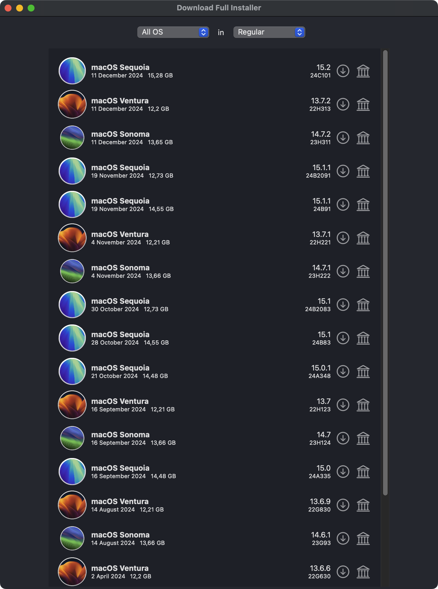

# Download Full Installer

&nbsp;&nbsp;&nbsp;

This is a Swift UI implementation of my [fetch-installer-pkg](https://github.com/scriptingosx/fetch-installer-pkg) script. It will list the full macOS Big Sur (and later) installer pkgs available for download in Apple's software update catalogs.

You can then choose to download one of them.

### Notes about version 2.0

GitHub user [matxpa](https://github.com/matxpa) has substantially modified this app by updating it to the most recent versions of macOS, fixing issues and adding improvements, hence the change to version 2.0:

* Improved Swift code with use of the swiftui Framework
* Preferences for choosing catalog are no longer a separate dialog but are now at the top of the main window
* A single macOS version or all versions can be displayed at once
* Beta versions are displayed if the correct catalog is selected (Beta word is only applied to the icon of the most recent macOS version)
* 2 buttons have been added
	* Download installer package
	* Create app from installer package.
* Spanish localization (@perez987).

### Motivation

You may want to download the installer pkg instead of the installer application directly, because you want to re-deploy the installer application with a management system, such as Jamf. 

Since the Big Sur macOS installer application contains a single file larger than 8GB, normal packaging tools will fail. I have described the problem and some solutions in detail in [this blog post](https://scriptingosx.com/2020/11/deploying-the-big-sur-installer-application/).

### Extras

- Copy the download URL for a given installer pkg from the context menu.

- Change the seed program in the Preferences window.

### Questions

#### Is this different than the fetch-installer-pkg script?

Not really, other than it is a UI app and written in Swift and SwiftUI instead of a command line script written in python. I used this as a project to learn more about SwiftUI.

#### Can this download older versions of the macOS installer application?

No. Apple only provides installer pkgs for Big Sur and later. Earlier versions of the Big Sur installer are removed regularly.

#### Will you update this so it can download older versions?

No.

#### How is this different than `softwareupdate` or `installinstallmacOS.py`

As far as I can tell, this downloads the same pkg as `softwareupdate --fetch-full-installer` and `installinstallmacOS.py`.

The difference is that the other tools then immediately perform the installation so that you get the installer application in the `/Applications` folder. This tool just downloads the pkg, so you can use it in your management system, archive the installer pkg, or manually run the installation.

### Credit

Both [fetch-installer-pkg](https://github.com/scriptingosx/fetch-installer-pkg) and this application are based on [Greg Neagle's installinstallmacos.py](https://github.com/munki/macadmin-scripts/blob/main/installinstallmacos.py) script.
